# core-identity-service architecture

Ticket: [CC-1291](https://linear.app/openearth/issue/CC-1291/architecture-document-for-core-identity-service). Parent: CC-1185.

This document describes how the service is built. It sits next to the
[extraction plan](./core-identity-v0-extraction-plan.md): the plan says what
moves out of CityCatalyst and in what order, and this document says what the
service looks like once it has moved.

## How to read this document

Three markers are used throughout, so the text cannot be read as a claim that
code exists when it does not.

| Marker          | Meaning                                                                                  |
| --------------- | ---------------------------------------------------------------------------------------- |
| **Implemented** | Exists on `develop` today.                                                               |
| **Planned**     | Designed here and tracked by a ticket. Not built.                                        |
| **Proposed**    | A design choice that still needs a decision. Listed in [section 13](#13-open-decisions). |

What exists today: the Next.js app with `GET /api/health/`, the identity
database schema (three migrations, seven tables), the Sequelize models and the
`db` connection, the script that copies data from CityCatalyst, the Dockerfile,
CI, and draft Kubernetes manifests that have not been applied. Everything else
in this document is planned.

Endpoint paths are proposed, not decided. Which paths the service owns on the
shared origin is still open (CC-1282).

## Contents

1. [Goals, non-goals and constraints](#1-goals-non-goals-and-constraints)
2. [System context](#2-system-context)
3. [Components and layering](#3-components-and-layering)
4. [Endpoint catalogue](#4-endpoint-catalogue)
5. [Data model](#5-data-model)
6. [Class diagrams](#6-class-diagrams)
7. [Data flow](#7-data-flow)
8. [Main flows](#8-main-flows)
9. [Lifecycles](#9-lifecycles)
10. [Token and session specification](#10-token-and-session-specification)
11. [Security design](#11-security-design)
12. [Deployment and operations](#12-deployment-and-operations)
13. [Open decisions](#13-open-decisions)
14. [Cutover phases and traceability](#14-cutover-phases-and-traceability)

Glossary: **OP** is the OpenID provider (this service). **RP** is a relying
party (CityCatalyst, other apps). **RS** is a resource server (an API that
accepts access tokens). **sub** is the stable user identifier in tokens.
**PKCE** is Proof Key for Code Exchange (RFC 7636). **JWKS** is the JSON Web
Key Set that publishes public signing keys. **amr** lists how the user
authenticated (for example `pwd`, `otp`).

---

## 1. Goals, non-goals and constraints

### Goals

- Be the only place that handles credentials: passwords, two-factor
  authentication, sessions, and the OAuth 2.0 and OpenID Connect protocol.
- Issue short-lived RS256 access tokens that any API can verify offline with the
  published JWKS, without holding a shared secret.
- Give users one sign-in across apps on the same origin, by redirect and
  without iframes.
- Run, deploy and scale independently of CityCatalyst, with its own database.

### Non-goals for v0

- Authorization. Roles, permission groups, and organization, project and city
  membership stay in CityCatalyst (`PermissionService`). Tokens identify the
  user. They do not grant rights.
- A role catalogue inside tokens (CC-1065 is not a v0 blocker).
- Dynamic client registration (RFC 7591), email and SMS one-time codes, social
  and enterprise federation (CC-678), and enabling the service in production.
- The app SDK (CC-1186), which consumes `prompt=none` and the claims defined
  here.
- Personal access tokens and Climate Advisor service tokens. They stay in
  CityCatalyst.

### Decisions this design follows

Taken from the decisions recorded on 2026-11-16 in the plan.

| Decision                                                                  | Consequence for the design                                                                                              |
| ------------------------------------------------------------------------- | ----------------------------------------------------------------------------------------------------------------------- |
| Own repository, Next.js for the MVP, extract before rewriting             | One deployable. Existing CityCatalyst logic moves with as few changes as possible.                                      |
| Separate database, no foreign keys across databases                       | Identity data and CityCatalyst data are joined only by the `sub` value. See [5.4](#54-cross-database-identity-mapping). |
| `sub` equals `User.userId` in CityCatalyst                                | Existing CityCatalyst foreign keys keep working. No mapping table.                                                      |
| CityCatalyst keeps a `User` row for profile data, `User.role` stays there | The identity service stores credentials, `email` and `name` only.                                                       |
| Sign-up and the email address move to the identity service                | CityCatalyst creates its profile row on first sign-in.                                                                  |
| Deletion: shell calls the identity API, then references are nulled        | See [8.7](#87-user-deletion).                                                                                           |
| One origin, route mapping, no iframes                                     | Session cookie is host-only and `SameSite=Lax`. Flows use top-level redirects.                                          |

---

## 2. System context

**Status: Planned.** Only the identity service box and its database exist as
code today, and the service only answers a health check.

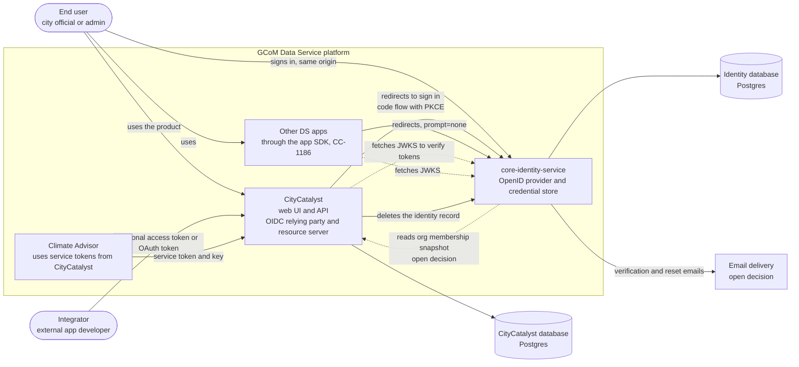

Notes:

- Climate Advisor and personal access tokens never pass through the identity
  service. CityCatalyst issues and checks them.
- The dotted edge from the identity service to CityCatalyst is how `org_ids`
  would be read when a token is issued. With two databases it has to be an API
  call or a pushed snapshot, not a database view. See decision 8.

---

## 3. Components and layering

### 3.1 Component view

**Status: Planned.** Only the `Models` and `db` boxes are implemented.

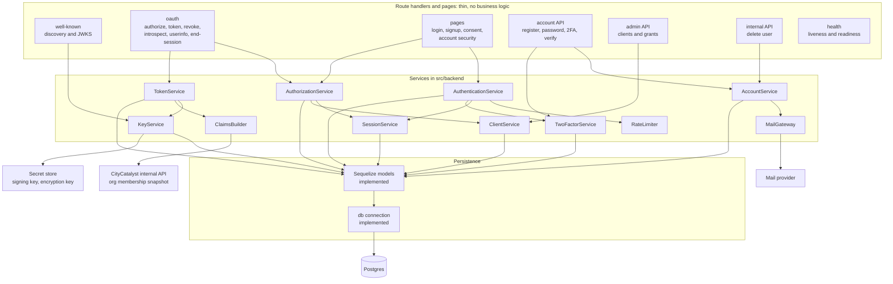

### 3.2 Layering rules

1. Route handlers parse and validate input, call one service, and shape the
   response. They contain no business logic. This matches the
   `apiHandler` convention in CityCatalyst.
2. Services own business rules and database transactions. A service never
   reads `req` or builds a `Response`.
3. Models only describe persistence. They contain no protocol logic.
4. Anything that touches a secret (signing key, encryption key, password
   hash) lives behind one service, so it can be audited in one place.
5. Services depend on interfaces for the three external dependencies (rate
   limit store, mail, org membership source), so the open decisions in section
   13 can change without touching protocol code.

### 3.3 Source layout

| Path                                               | Status      | Contents                                         |
| -------------------------------------------------- | ----------- | ------------------------------------------------ |
| `src/app/api/health/`                              | Implemented | Liveness probe.                                  |
| `src/models/`                                      | Implemented | Seven models, `init-models.ts`, `db` connection. |
| `scripts/copy-from-citycatalyst.ts`                | Implemented | Copies users, clients and grants.                |
| `migrations/`, `config/`                           | Implemented | `.cjs` migrations and `sequelize-cli` config.    |
| `src/app/.well-known/`, `src/app/oauth/`           | Planned     | Discovery, JWKS and protocol routes.             |
| `src/app/(pages)/`                                 | Planned     | Login, signup, consent, account pages.           |
| `src/app/api/auth/`, `api/admin/`, `api/internal/` | Planned     | Account, admin and internal APIs.                |
| `src/backend/`                                     | Planned     | One service per file (section 6.2).              |
| `src/lib/`                                         | Planned     | Crypto helpers, cookie helpers, config, logger.  |

---

## 4. Endpoint catalogue

**Status: Planned**, except the health check. Paths are proposed. All paths sit
under a configurable base path, and `trailingSlash` is on, so each path is
served with a trailing slash.

### 4.1 Endpoints

| Method and path                                                                                                  | Purpose                                                    | Caller and auth                              | Standard                      | Ticket           |
| ---------------------------------------------------------------------------------------------------------------- | ---------------------------------------------------------- | -------------------------------------------- | ----------------------------- | ---------------- |
| `GET /api/health/`                                                                                               | Liveness. Does not touch the database. **Implemented.**    | Kubernetes probe, none                       |                               | CC-1271          |
| `GET /api/ready/`                                                                                                | Readiness. Checks the database. **Proposed**, decision 13. | Kubernetes probe, none                       |                               | CC-1282          |
| `GET /.well-known/openid-configuration`                                                                          | Discovery document                                         | Anyone                                       | OIDC Discovery 1.0            | CC-1275          |
| `GET /.well-known/jwks.json`                                                                                     | Public signing keys, cacheable                             | Anyone                                       | RFC 7517                      | CC-1275          |
| `GET /oauth/authorize`                                                                                           | Start an authorization request                             | Browser, OP session cookie                   | RFC 6749, RFC 7636, OIDC Core | CC-1275, CC-1280 |
| `POST /oauth/token`                                                                                              | Exchange a code, refresh a token                           | Client: none (PKCE) or `client_secret_basic` | RFC 6749                      | CC-1275, CC-1277 |
| `GET, POST /oauth/userinfo`                                                                                      | Profile claims                                             | Bearer access token                          | OIDC Core                     | CC-1275          |
| `POST /oauth/revoke`                                                                                             | Revoke a refresh token or its family                       | Client                                       | RFC 7009                      | CC-1277          |
| `POST /oauth/introspect`                                                                                         | Check a token                                              | Registered resource server                   | RFC 7662                      | CC-1277          |
| `GET /oauth/end-session`                                                                                         | Sign out of the OP session                                 | Browser                                      | OIDC RP-Initiated Logout      | CC-1281          |
| `GET /login`, `/signup`, `/forgot-password`, `/reset-password`, `/verify-email`, `/consent`, `/account/security` | Pages                                                      | Browser                                      |                               | CC-1279, CC-1280 |
| `POST /api/auth/login`                                                                                           | Check password and second factor, create session           | Browser, rate limited                        |                               | CC-1279          |
| `POST /api/auth/logout`                                                                                          | End the OP session                                         | Browser                                      |                               | CC-1279          |
| `POST /api/auth/register`                                                                                        | Sign up                                                    | Browser, rate limited                        |                               | CC-1279          |
| `POST /api/auth/password/forgot`, `/reset`, `/change`                                                            | Password reset and change                                  | Browser                                      |                               | CC-1279          |
| `GET, POST /api/auth/email/verify`                                                                               | Email verification                                         | Browser                                      |                               | CC-1279          |
| `POST /api/auth/2fa/setup`, `/verify`, `/disable`, `GET /status`                                                 | Two-factor management                                      | Browser, session                             |                               | CC-1279          |
| `GET, POST /api/admin/clients`, `/{clientId}`                                                                    | Client administration                                      | Platform admin                               |                               | CC-1280          |
| `GET /api/account/grants`, `DELETE /{clientId}`                                                                  | List and revoke the user's grants                          | Browser, session                             |                               | CC-1280          |
| `DELETE /api/internal/users/{sub}`                                                                               | Delete an identity                                         | Service credential from the shell app        |                               | CC-1284          |

### 4.2 Where each endpoint comes from in CityCatalyst

Verified against the CityCatalyst code during the audit for the plan.

| CityCatalyst today                              | Becomes                                    | Ticket           |
| ----------------------------------------------- | ------------------------------------------ | ---------------- |
| Credentials `authorize()` in `src/lib/auth.ts`  | `POST /api/auth/login` plus the OP session | CC-1279          |
| `POST /api/v1/auth/register`                    | `POST /api/auth/register`                  | CC-1279          |
| `POST /api/v1/auth/forgot`                      | `POST /api/auth/password/forgot`           | CC-1279          |
| `POST /api/v1/auth/password`                    | `POST /api/auth/password/reset`            | CC-1279          |
| `POST /api/v1/auth/update-password`             | `POST /api/auth/password/change`           | CC-1279          |
| `GET, POST /api/v1/auth/verify`                 | `/api/auth/email/verify`                   | CC-1279          |
| `/api/v1/auth/2fa/{setup,verify,disable,check}` | `/api/auth/2fa/...`                        | CC-1279          |
| `POST /api/v1/auth/code`                        | Folded into `GET /oauth/authorize`         | CC-1275, CC-1280 |
| `POST /api/v1/token`                            | `POST /oauth/token`                        | CC-1275, CC-1277 |
| `GET /api/v1/oauth/metadata`                    | `/.well-known/openid-configuration`        | CC-1275          |
| `/api/v1/client`, `/api/v1/client/[client]`     | `/api/admin/clients`                       | CC-1280          |
| `/api/v1/user/clients`, `/[client]`             | `/api/account/grants`                      | CC-1280          |
| `[lng]/authorize` page                          | `/consent` page                            | CC-1280          |
| `POST /api/v1/auth/delete`                      | `DELETE /api/internal/users/{sub}`         | CC-1284          |

---

## 5. Data model

### 5.1 Identity database

**Status: Implemented.** Created by the three migrations in `migrations/`. All
foreign keys are `ON UPDATE CASCADE ON DELETE CASCADE`. There are no foreign
keys to CityCatalyst.

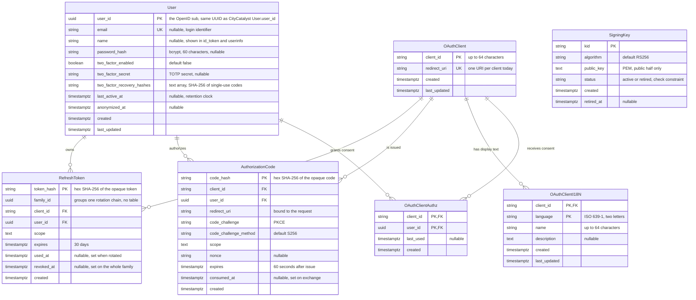

Indexes: unique on `User.email`, `OAuthClient.redirect_uri`; on
`User.last_active_at`, `User.anonymized_at`, `AuthorizationCode.expires`,
`RefreshToken.family_id`, `RefreshToken.user_id`.

Design notes:

- Codes and refresh tokens are stored as SHA-256 hashes of random 256-bit
  values. A stolen database dump cannot be replayed. A plain hash is enough
  here because the inputs are high-entropy random values, unlike passwords.
- `SigningKey` holds only the public half. The private key is read from the
  environment or a secret store and is never written to the database.
- The identity `User` has no profile fields beyond `name`. CityCatalyst keeps
  title, picture, language, number format and default city or inventory.

### 5.2 Tables and columns still to be added

**Status: Proposed.** None of this is in a migration. Each item is tied to the
decision that needs to be made first.

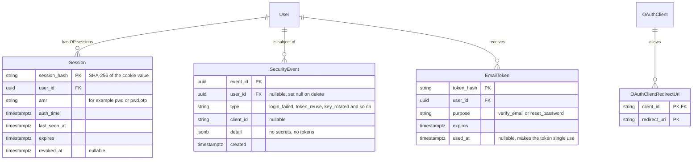

Columns to add to existing tables:

| Table               | Column                                             | Why                                                                                       | Decision |
| ------------------- | -------------------------------------------------- | ----------------------------------------------------------------------------------------- | -------- |
| `User`              | `email_verified_at`                                | The `email_verified` claim needs a source. CityCatalyst has no verification flag today.   | 9        |
| `OAuthClient`       | `first_party boolean`                              | Skip the consent screen for CityCatalyst.                                                 | 5        |
| `OAuthClient`       | `token_endpoint_auth_method`, `client_secret_hash` | Confidential clients (`client_secret_basic`).                                             | 12       |
| `OAuthClient`       | drop `redirect_uri`, use `OAuthClientRedirectUri`  | Several redirect URIs per client.                                                         | 12       |
| `AuthorizationCode` | `family_id uuid`                                   | Revoke the tokens issued from a code when that code is replayed (RFC 6749 section 4.1.2). | 10       |

### 5.3 Data classification and protection

| Data                                          | Where                                          | Class         | Protection                                                                                                                                                                                                        |
| --------------------------------------------- | ---------------------------------------------- | ------------- | ----------------------------------------------------------------------------------------------------------------------------------------------------------------------------------------------------------------- |
| `password_hash`                               | `User`                                         | Secret        | bcrypt. CityCatalyst uses cost 12 in register and reset and cost 10 in change-password. Use 12 everywhere. bcrypt only reads the first 72 bytes of a password, so decide how to handle longer ones (decision 16). |
| `two_factor_secret`                           | `User`                                         | Secret        | Stored as plain text in CityCatalyst today (the code passes the column value to the TOTP verifier). Proposed: encrypt at rest (decision 6).                                                                       |
| `two_factor_recovery_hashes`                  | `User`                                         | Secret        | SHA-256 of single-use codes. Consumed on use.                                                                                                                                                                     |
| Authorization codes, refresh tokens, sessions | `AuthorizationCode`, `RefreshToken`, `Session` | Secret        | Only SHA-256 hashes stored.                                                                                                                                                                                       |
| Private signing key                           | Environment or secret store                    | Secret        | Never in the database, never logged.                                                                                                                                                                              |
| `email`, `name`                               | `User`                                         | Personal data | Anonymized by the retention job (row kept). Never written to logs.                                                                                                                                                |
| `last_active_at`, `anonymized_at`             | `User`                                         | Personal data | Used by retention. Ownership of the job is open (decision 14).                                                                                                                                                    |
| `client_id`, `redirect_uri`, display text     | `OAuthClient*`                                 | Public        | None needed.                                                                                                                                                                                                      |
| Public signing keys                           | `SigningKey`, JWKS                             | Public        | Served with cache headers.                                                                                                                                                                                        |

### 5.4 Cross-database identity mapping

The two databases are joined by one value. There is no foreign key, no shared
table and no cross-database query.

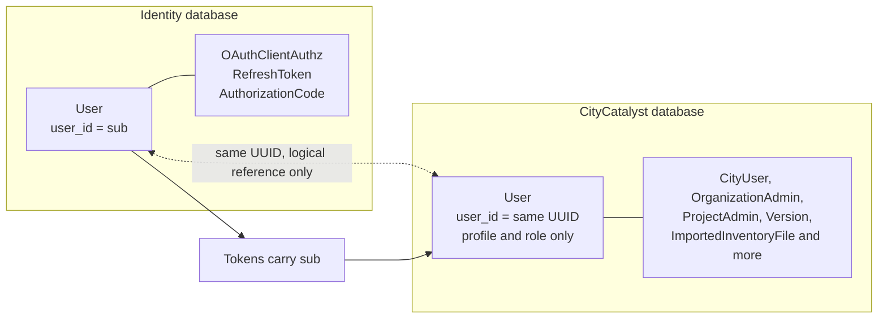

Consequences:

- A row in CityCatalyst can point at a user that no longer exists in the
  identity database. That is intended: after deletion, kept data has its user
  reference set to null ([8.7](#87-user-deletion)).
- A sign-in can arrive for a `sub` that CityCatalyst has never seen. CityCatalyst
  creates a profile row on first sign-in ([8.1](#81-sign-in-with-openid-connect)).
- Email lives in both places. The identity service owns it. CityCatalyst keeps
  a copy for display, invites and notifications. How a change reaches the copy
  is open (decision 15).

---

## 6. Class diagrams

### 6.1 Domain models

**Status: Implemented** (`src/models/`). Attribute names are the TypeScript
names. The mapping to column names is in each model file.

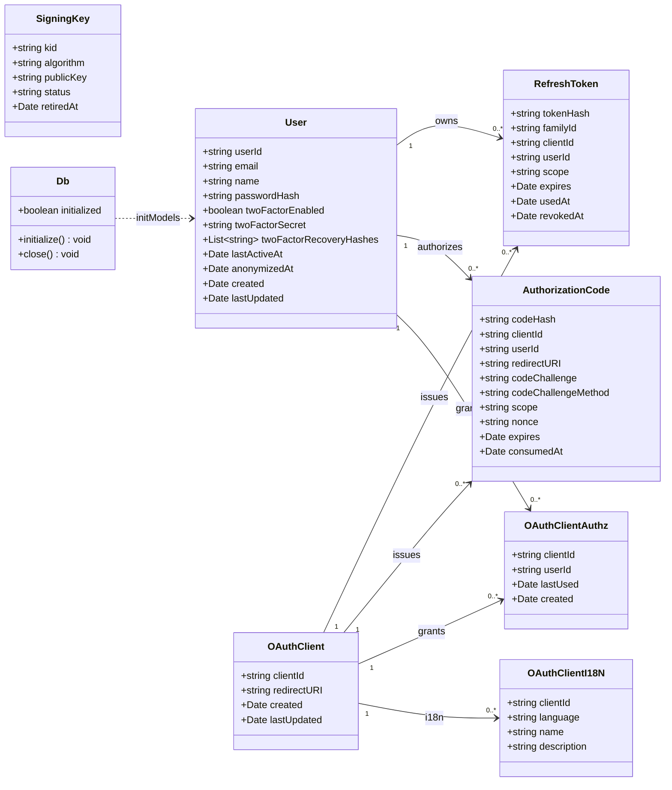

### 6.2 Service layer

**Status: Planned.** Names and signatures are illustrative. They fix the
responsibilities and the dependency direction, not the final code.

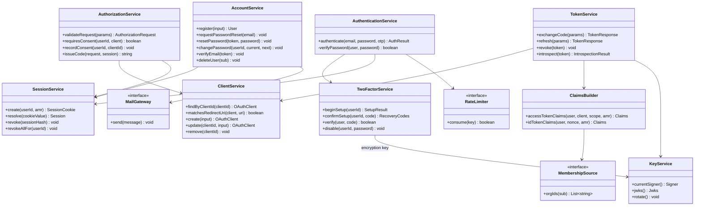

Interfaces exist for the three decisions that are still open: where rate limit
counters live, how mail is sent, and how `org_ids` is read from CityCatalyst.

---

## 7. Data flow

### 7.1 Data flow diagram with trust boundaries

**Status: Planned.** Circles-and-boxes view of where data enters, what
processes it, where it rests, and which boundaries it crosses.

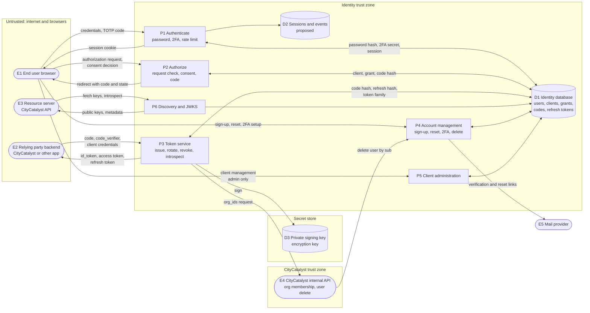

Data crossing a boundary, and what protects it:

| Flow               | Data                                                        | Protection                                                                        |
| ------------------ | ----------------------------------------------------------- | --------------------------------------------------------------------------------- |
| Browser to P1      | Password, TOTP code                                         | TLS only. Rate limited. Never logged.                                             |
| P1 to browser      | Session cookie                                              | `HttpOnly`, `Secure`, `SameSite=Lax`, host-only.                                  |
| RP to P3           | Code, PKCE verifier, client secret for confidential clients | TLS. Code is single use and expires in 60 seconds.                                |
| P3 to RP           | Tokens                                                      | TLS. Access and id tokens last 15 minutes. Refresh tokens rotate.                 |
| P3 to secret store | Signing operation                                           | Private key stays in the store or process memory.                                 |
| P3 to CityCatalyst | Membership request                                          | Service credential. Bounded timeout. Failure does not block sign-in (decision 8). |
| P4 to mail         | One-time links                                              | Single use, short lifetime, no password or token in logs.                         |
| CityCatalyst to P4 | Delete request                                              | Service credential. Idempotent.                                                   |

---

## 8. Main flows

### 8.1 Sign-in with OpenID Connect

**Status: Planned.** CityCatalyst signing in through the identity service, with
the authorization code flow and PKCE. The consent step appears only for
clients that are not first party (decision 5).

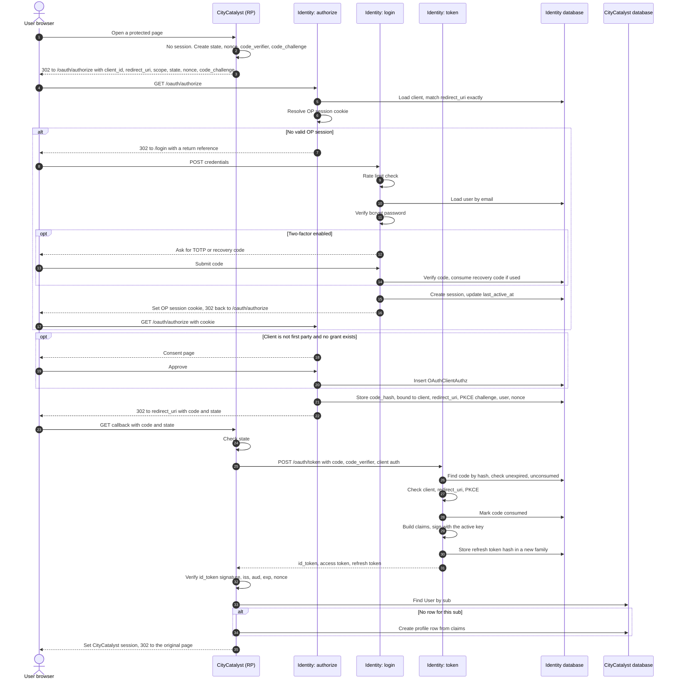

### 8.2 Silent sign-in for a second app

**Status: Planned.** Uses a top-level redirect, so the host-only
`SameSite=Lax` cookie is sent. No iframe is involved.

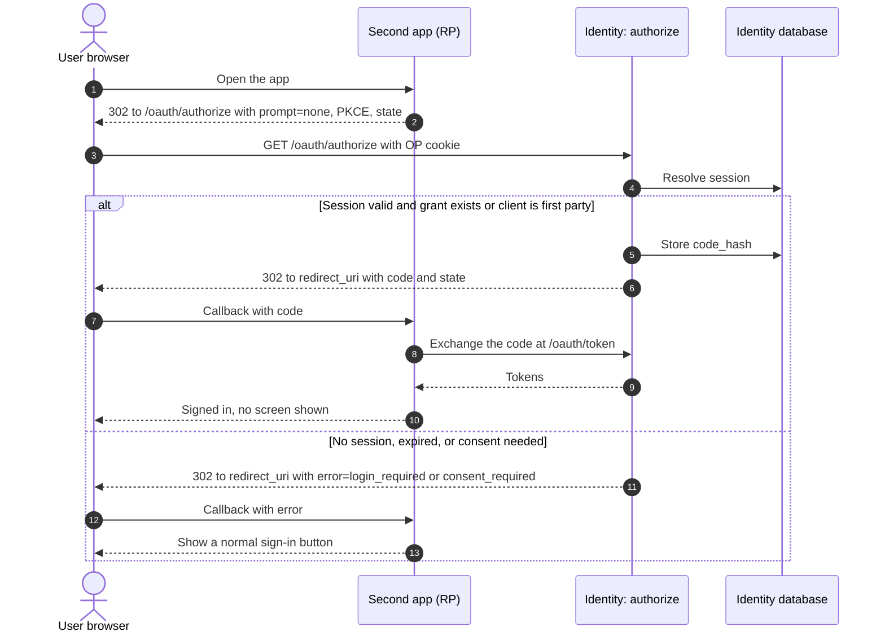

### 8.3 Calling an API with an access token

**Status: Planned** (CC-1278). The resource server verifies locally and does
not call the identity service on the hot path.

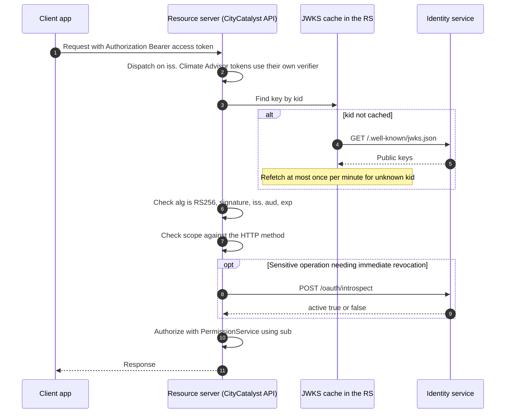

### 8.4 Refresh token rotation and reuse detection

**Status: Planned** (CC-1277).

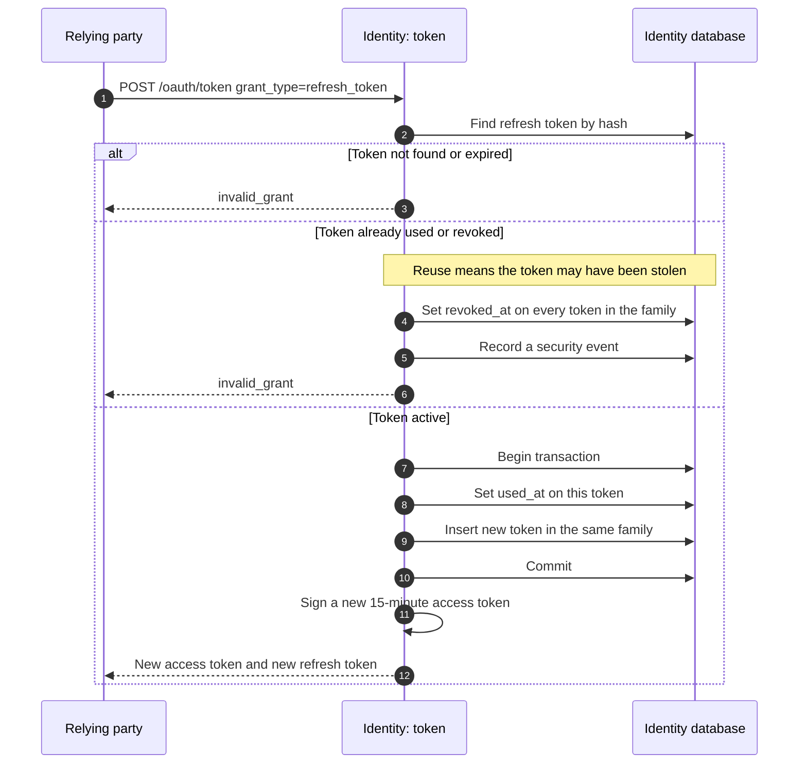

The `used_at` update must be a conditional update (`WHERE used_at IS NULL`)
inside the transaction. Two concurrent refreshes then cannot both succeed.

### 8.5 Signing key rotation

**Status: Planned** (CC-1275).

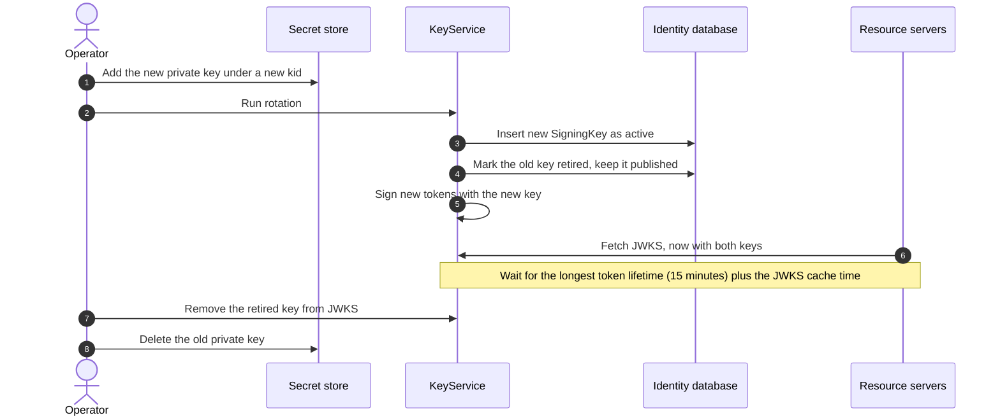

A key that may be compromised is rotated the same way, but the old public key
is removed at once and all refresh token families are revoked.

### 8.6 Sign-up and email verification

**Status: Planned** (CC-1279). Mail delivery is an open decision.

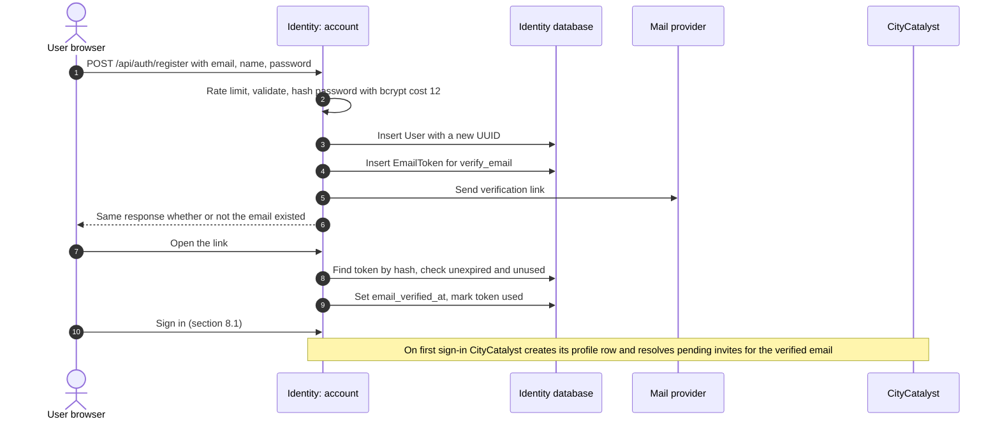

### 8.7 User deletion

**Status: Planned** (CC-1284). The identity record goes first, so the user
cannot sign in again even if the CityCatalyst step fails and has to be
retried.

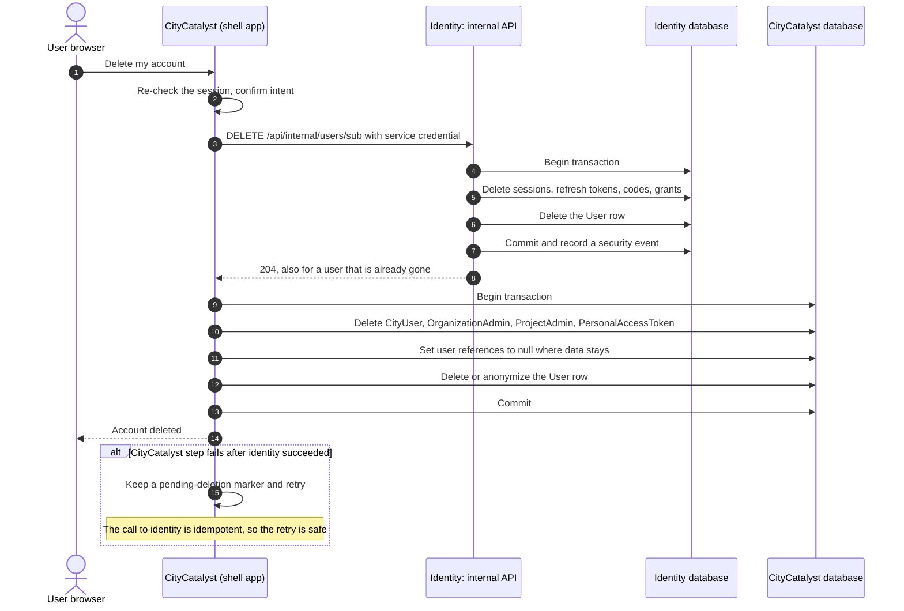

Data that stays with a null user: `Version`, `ImportedInventoryFile`,
`UserFile` (needs the CC-1274 migration), the ingest and job tables,
`ConsentRecord`, `WebhookSubscription`.

### 8.8 Moving data from CityCatalyst

**Status: Implemented** (`npm run db:copy-from-citycatalyst`).

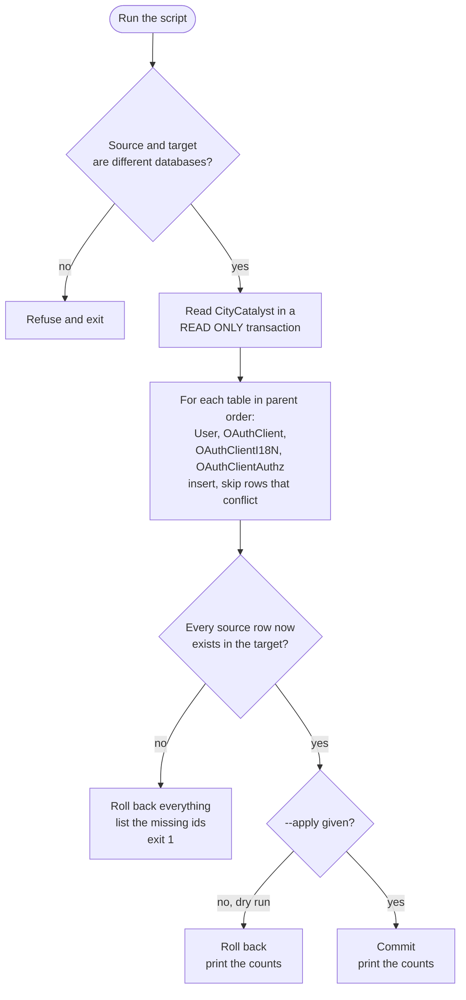

---

## 9. Lifecycles

### 9.1 Authorization code

**Status: Planned.** The table and model exist.

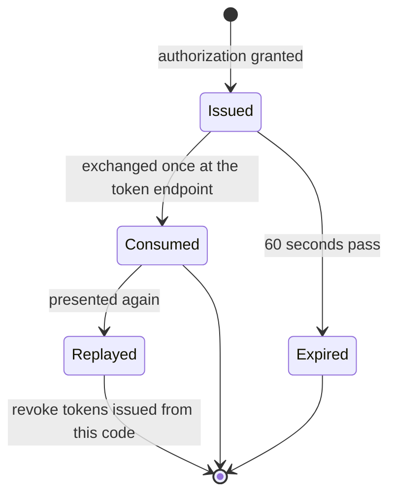

### 9.2 Refresh token

**Status: Planned.** The table and model exist.

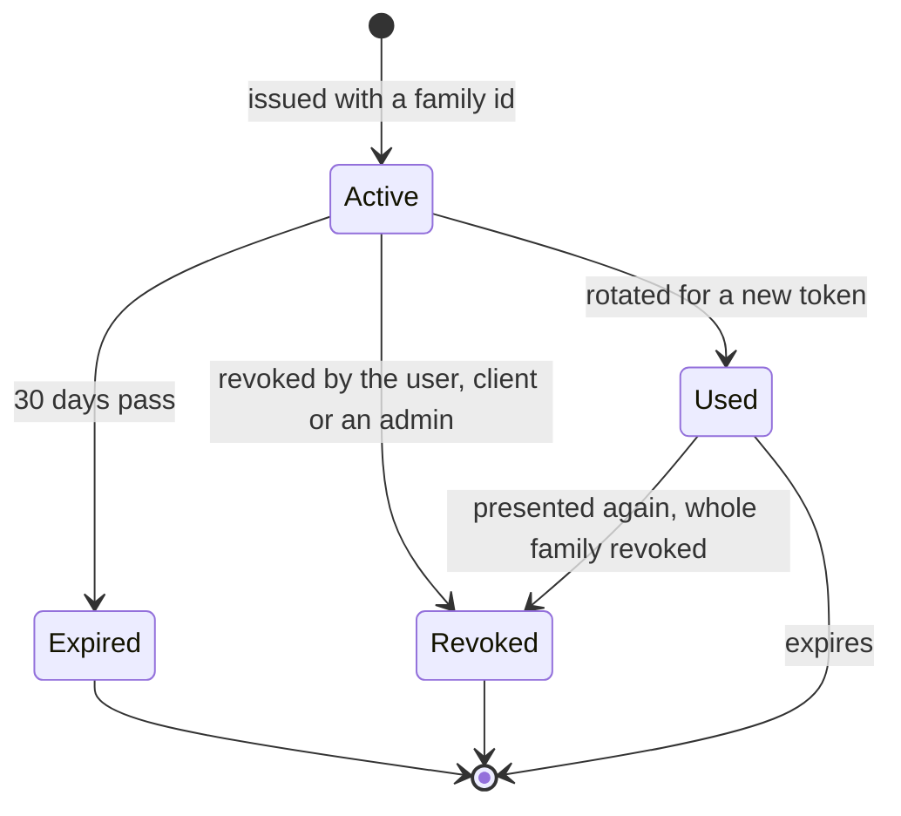

### 9.3 OP session

**Status: Proposed** (decision 3).

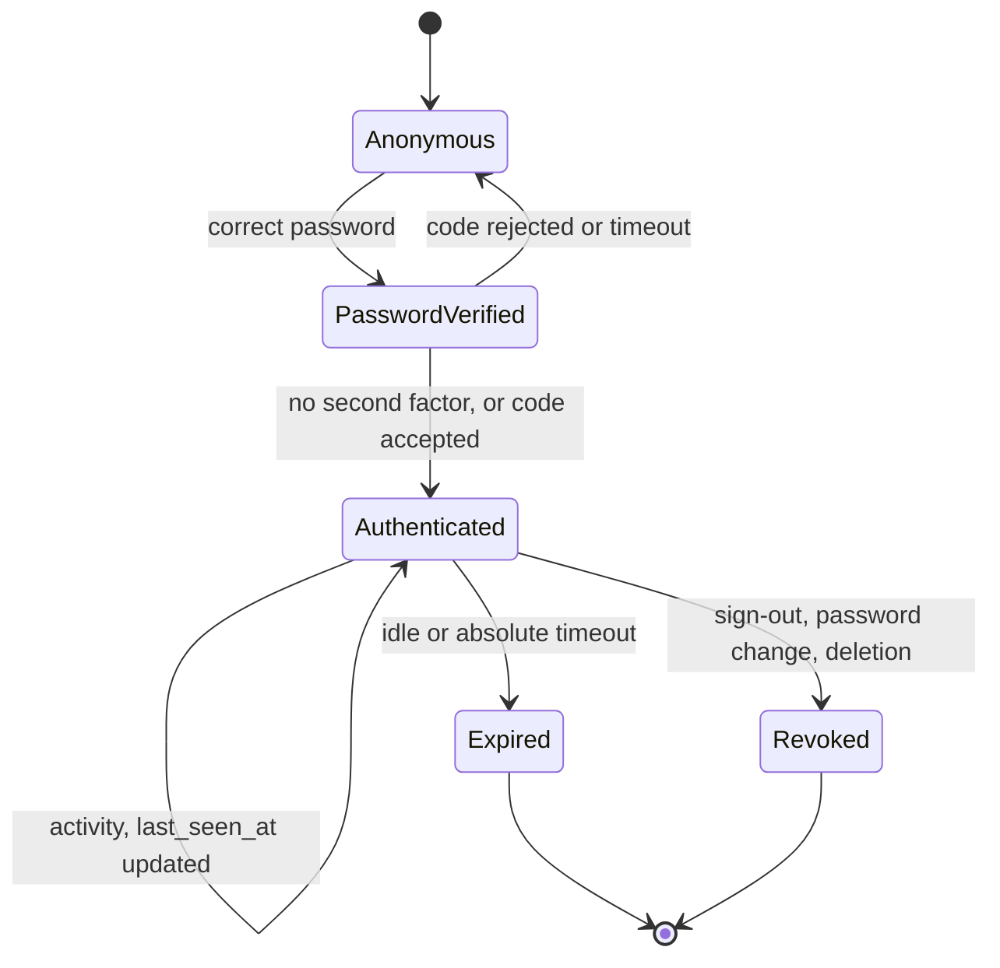

A password change or a two-factor change revokes all other sessions and
refresh token families of that user.

### 9.4 Signing key

**Status: Implemented** (the `status` column and check constraint). The
rotation procedure is planned.

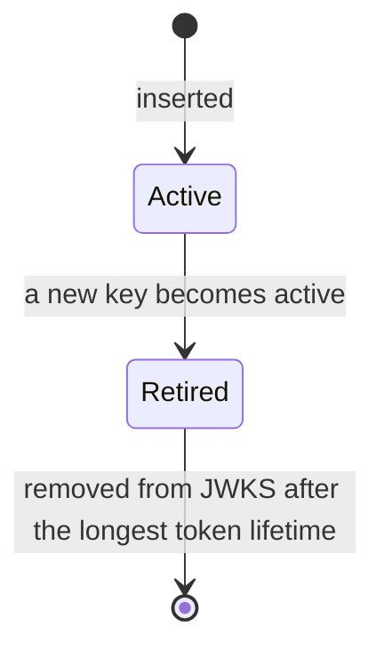

---

## 10. Token and session specification

**Status: Planned.** Values follow the plan's token shape. Payloads below use
made-up values.

### 10.1 Artifacts

| Artifact                           | Format                 | Lifetime                                   | Storage                             | Notes                                                            |
| ---------------------------------- | ---------------------- | ------------------------------------------ | ----------------------------------- | ---------------------------------------------------------------- |
| Authorization code                 | Opaque, 256-bit random | 60 seconds                                 | SHA-256 hash in `AuthorizationCode` | Single use. Bound to client, redirect URI, PKCE challenge, user. |
| Access token                       | JWT, RS256             | 15 minutes                                 | Not stored                          | One platform audience.                                           |
| id_token                           | JWT, RS256             | 15 minutes                                 | Not stored                          | Includes `nonce`.                                                |
| Refresh token                      | Opaque, 256-bit random | 30 days                                    | SHA-256 hash in `RefreshToken`      | Rotates on every use.                                            |
| OP session cookie                  | Opaque random value    | Idle timeout and absolute limit, to decide | SHA-256 hash in `Session`           | See 10.4.                                                        |
| Email verification and reset token | Opaque random value    | Short, to decide                           | SHA-256 hash in `EmailToken`        | Proposed. CityCatalyst uses stateless JWTs today (decision 11).  |

CityCatalyst today, for comparison: codes are 5-minute signed JWTs with a
`UsedAuthorizationCode` table for replay, access tokens last 7 days, refresh
tokens last 30 days and are not rotated, and everything is HS256 under
`VERIFICATION_TOKEN_SECRET`.

### 10.2 Claims

Access token and id_token carry the same identity claims in v0, as set in the
plan.

```json
{
  "iss": "https://identity.example.org",
  "sub": "11111111-1111-1111-1111-111111111111",
  "aud": "gcom-ds-platform",
  "exp": 1790000900,
  "iat": 1790000000,
  "jti": "b1c2d3e4-0000-0000-0000-000000000000",
  "client_id": "citycatalyst-web",
  "scope": "openid read write",
  "amr": ["pwd", "otp"],
  "email": "user@example.org",
  "email_verified": true,
  "name": "Example User",
  "org_ids": ["22222222-2222-2222-2222-222222222222"]
}
```

The id_token also has `aud` set to the client id, `auth_time` and `nonce`.

`client_id` and `scope` are in CityCatalyst's tokens today. The identity claims
(`amr`, `email`, `email_verified`, `name`, `org_ids`) come from the plan. `jti`
is **proposed**, so a token can be traced in logs and revoked by id if needed.

| Claim            | Source                           | Notes                                                                                   |
| ---------------- | -------------------------------- | --------------------------------------------------------------------------------------- |
| `sub`            | `User.user_id`                   | Stable UUID.                                                                            |
| `email`, `name`  | `User`                           |                                                                                         |
| `email_verified` | `User.email_verified_at`         | Needs the column (decision 9).                                                          |
| `amr`            | The session                      | `["pwd"]` or `["pwd","otp"]`.                                                           |
| `org_ids`        | CityCatalyst membership snapshot | Best effort. An empty array is valid. May be stale until the next refresh (decision 8). |
| `scope`          | The grant                        | `openid`, plus `read` and `write` for the CityCatalyst API.                             |

No role or permission is copied into a token. `active_org_id` is omitted.

### 10.3 Discovery document

```json
{
  "issuer": "https://identity.example.org",
  "authorization_endpoint": "https://identity.example.org/oauth/authorize/",
  "token_endpoint": "https://identity.example.org/oauth/token/",
  "userinfo_endpoint": "https://identity.example.org/oauth/userinfo/",
  "jwks_uri": "https://identity.example.org/.well-known/jwks.json",
  "revocation_endpoint": "https://identity.example.org/oauth/revoke/",
  "introspection_endpoint": "https://identity.example.org/oauth/introspect/",
  "end_session_endpoint": "https://identity.example.org/oauth/end-session/",
  "response_types_supported": ["code"],
  "grant_types_supported": ["authorization_code", "refresh_token"],
  "code_challenge_methods_supported": ["S256"],
  "id_token_signing_alg_values_supported": ["RS256"],
  "token_endpoint_auth_methods_supported": ["none", "client_secret_basic"],
  "scopes_supported": ["openid", "read", "write"],
  "subject_types_supported": ["public"]
}
```

### 10.4 Session cookie

| Attribute  | Value                | Reason                                                                     |
| ---------- | -------------------- | -------------------------------------------------------------------------- |
| Name       | `__Host-cci_session` | The `__Host-` prefix forces `Secure`, `Path=/` and no `Domain`.            |
| `HttpOnly` | yes                  | Not readable from script.                                                  |
| `Secure`   | yes                  | Over TLS only. Local development needs an exception.                       |
| `SameSite` | `Lax`                | Sent on top-level redirects back from apps, not on cross-site subrequests. |
| Domain     | none (host-only)     | Only the identity host receives it.                                        |

### 10.5 What a resource server must check

1. Dispatch on `iss`. Only tokens from this issuer go to the JWKS verifier.
2. `alg` is `RS256`. Reject `none` and any HMAC algorithm.
3. Signature verifies with the key matching `kid`.
4. `iss` equals the configured issuer. `aud` contains the platform audience.
5. `exp` is in the future, with a small clock skew. `iat` is not in the future.
6. `scope` allows the HTTP method (`read` for GET and HEAD, `write` for the
   rest).
7. Authorization decisions use the resource server's own data and `sub`.
   `org_ids` is a hint, never the source of an access decision.

---

## 11. Security design

### 11.1 Threats and mitigations

| Threat                                                                 | Mitigation                                                                                                                     | Ticket              |
| ---------------------------------------------------------------------- | ------------------------------------------------------------------------------------------------------------------------------ | ------------------- |
| Credential stuffing, brute force                                       | Per-email and per-IP rate limits in a shared store, uniform responses and timing, bcrypt cost 12                               | CC-1279             |
| Account enumeration through sign-up, reset or login                    | Same response and similar timing whether or not the email exists                                                               | CC-1279             |
| Authorization code interception                                        | PKCE S256 required, 60-second single-use codes, exact redirect URI match                                                       | CC-1275             |
| Code replay across replicas                                            | Code stored as a database row, consumed in a conditional update                                                                | CC-1275             |
| Refresh token theft                                                    | Rotation on every use, reuse revokes the family, hashed at rest                                                                | CC-1277             |
| Token confusion (invite token used as an access token, or the reverse) | Separate keys per purpose, pinned algorithm, `iss` and `aud` checks                                                            | CC-1272, CC-1278    |
| Open redirect                                                          | Redirect URIs matched as exact strings, no wildcards, no `return_to` outside the origin                                        | CC-1280             |
| CSRF on login, consent and account changes                             | Per-session CSRF token on every state-changing form, `SameSite=Lax`, `state` on authorization requests                         | CC-1280             |
| Session fixation                                                       | New session value on every sign-in, old one revoked                                                                            | CC-1279             |
| Stolen database dump                                                   | Secrets hashed or encrypted, private key not in the database                                                                   | CC-1276, decision 6 |
| Signing key compromise                                                 | Rotation procedure, retire and remove, revoke all families                                                                     | CC-1275             |
| Malicious or buggy client                                              | Registered clients only, admin-only registration in v0                                                                         | CC-1280             |
| Dependency vulnerabilities                                             | Lockfile, CI, image runs as non-root uid 1001. `npm audit` currently lists findings in the ESLint toolchain only (development) | CC-1271             |

### 11.2 Rules for the code

- Never log passwords, codes, tokens, TOTP secrets or recovery codes.
- Do not log email addresses. CityCatalyst's login limiter logs the email when a
  limit is hit (`logger.error({ email }, ...)` in `src/lib/auth.ts`). Do not
  carry that over. Use the `sub` or a hash.
- Use `crypto.timingSafeEqual` for any comparison of secrets and hashes.
- Generate randomness with `crypto.randomBytes`, never `Math.random`.
- Validate every request body with a schema (Zod, as in CityCatalyst).
- Keep CORS closed. The protocol endpoints that browsers call cross-origin are
  `userinfo`, `token` for public clients, `jwks` and discovery, and each gets an
  explicit rule.
- Return OAuth errors in the standard JSON form. Do not leak whether a client
  or user exists.

### 11.3 Secrets and configuration

| Variable                                                            | Status      | Purpose                                            |
| ------------------------------------------------------------------- | ----------- | -------------------------------------------------- |
| `DATABASE_HOST`, `_PORT`, `_NAME`, `_USER`, `_PASSWORD`, `_USE_SSL` | Implemented | Identity database.                                 |
| `CITYCATALYST_DATABASE_*`                                           | Implemented | Only for the copy script.                          |
| `OAUTH_SIGNING_KEY`                                                 | Planned     | RS256 private key (PEM). Name matches CC-1272.     |
| `OAUTH_SIGNING_KEY_ID`                                              | Planned     | The active `kid`.                                  |
| `ISSUER_URL`                                                        | Planned     | The `iss` value and the base of discovery URLs.    |
| `PLATFORM_AUDIENCE`                                                 | Planned     | The single `aud` value for access tokens.          |
| `IDENTITY_ENCRYPTION_KEY`                                           | Proposed    | Encrypts TOTP secrets at rest (decision 6).        |
| `RESET_TOKEN_SECRET`                                                | Planned     | Only if reset tokens stay stateless (decision 11). |
| `CC_INTERNAL_API_URL`, service credential                           | Proposed    | Membership snapshot and the delete call.           |
| Mail settings                                                       | Proposed    | Decision 7.                                        |

---

## 12. Deployment and operations

### 12.1 Topology

**Status: Proposed.** The Dockerfile, CI and a draft manifest exist
(`k8s/dev/core-identity.yml`). Nothing is applied to a cluster. Where the
manifests live, the namespace, the hostname and the database location are
open (CC-1282).

```mermaid
flowchart TB
    internet(["Browsers and apps"])

    subgraph cluster["Kubernetes cluster, dev"]
        ingress["Ingress<br/>shared origin, route mapping"]
        subgraph idapp["core-identity"]
            svc["Service<br/>port 3000"]
            pods["Deployment<br/>Next.js standalone, uid 1001<br/>probes on /api/health/"]
        end
        ccweb["cc-web<br/>CityCatalyst"]
        idsecret["Secret<br/>signing key, DB credentials"]
        migrate["Migration job<br/>sequelize-cli, open decision"]
    end

    pg[("Identity Postgres<br/>in cluster or RDS, open")]
    ccpg[("CityCatalyst Postgres")]

    subgraph cicd["GitHub"]
        ci["CI: lint, typecheck, build, docker build"]
        ghcr["GHCR image<br/>pushed from develop"]
        deploy["deploy-dev.yml<br/>manual, needs cluster secrets"]
    end

    internet --> ingress
    ingress -->|"identity paths"| svc
    ingress -->|"all other paths"| ccweb
    svc --> pods
    pods --> pg
    pods --> idsecret
    migrate --> pg
    ccweb --> ccpg
    ccweb -.->|"JWKS, token, delete"| svc

    ci --> ghcr
    ghcr --> deploy
    deploy -->|"kubectl apply and set image"| pods
```

### 12.2 Operational requirements

- **Stateless pods.** All state is in Postgres. Codes, refresh tokens and
  sessions are database rows, so two or more replicas are safe. The rate limit
  store must also be shared (decision 4).
- **Probes.** Liveness is `GET /api/health/` and does not touch the database.
  Add a readiness probe that checks the database, so a pod without a database
  is taken out of rotation instead of restarted.
- **Migrations.** The runtime image has no `sequelize-cli` or migration files.
  A migration job or an extra Docker target is needed (open).
- **JWKS caching.** Serve with `Cache-Control` so resource servers do not call
  the service per request.
- **Backups.** The identity database holds credentials. Back it up and test
  restore. Back up before running the copy script with `--apply` on a shared
  database.
- **Runbooks to write:** key rotation, emergency revoke of all sessions and
  refresh tokens, restore from backup, rotate the database password.
- **Logging.** JSON logs (pino, as in CityCatalyst) with a request id, no
  secrets, no emails.

---

## 13. Open decisions

Each needs an owner before the ticket that depends on it can finish.

| #   | Decision                                                       | Options                                                                                                         | Recommendation                                                                                     | Needed by                  |
| --- | -------------------------------------------------------------- | --------------------------------------------------------------------------------------------------------------- | -------------------------------------------------------------------------------------------------- | -------------------------- |
| 1   | Paths the service owns on the shared origin, and the base path | Prefix such as `/identity`, or root paths after CC-1283 removes the old routes                                  | A prefix now, with `basePath` set in Next.js                                                       | CC-1282                    |
| 2   | Where the manifests live                                       | This repository, or CityCatalyst's `k8s/`                                                                       | This repository, referenced from the shared ingress                                                | CC-1282                    |
| 3   | OP session storage                                             | Database table, signed cookie only, Redis                                                                       | Database table with a hashed cookie value (revocable, no new infrastructure)                       | CC-1279                    |
| 4   | Rate limit store                                               | Database counters, Redis                                                                                        | Database counters first. Move to Redis only if load needs it                                       | CC-1279                    |
| 5   | Skip consent for CityCatalyst                                  | `first_party` flag on `OAuthClient`, or always show consent                                                     | A flag, default false                                                                              | CC-1280                    |
| 6   | TOTP secret at rest                                            | Plain text (as today), application-level encryption                                                             | AES-256-GCM with a key from env and a key version column                                           | CC-1276 follow-up, CC-1279 |
| 7   | Mail delivery                                                  | Identity sends directly, or calls one CityCatalyst mail endpoint                                                | Direct, to avoid a runtime dependency on CityCatalyst. The plan allows either                      | CC-1279                    |
| 8   | Source of `org_ids`                                            | Service call to CityCatalyst, pushed snapshot. The plan's "read-only view" is not possible across two databases | Service call with a short timeout. If it fails, issue the token with an empty `org_ids` and log it | CC-1275                    |
| 9   | `email_verified` source                                        | New `email_verified_at` column. Decide the value for copied users                                               | Add the column. Treat copied users as unverified unless CityCatalyst has a signal                  | CC-1275, CC-1279           |
| 10  | Revoke tokens when a code is replayed                          | Add `family_id` to `AuthorizationCode`, or skip                                                                 | Add it. RFC 6749 recommends revoking                                                               | CC-1275                    |
| 11  | Reset and verification tokens                                  | Stateless JWT (as today), single-use rows in `EmailToken`                                                       | Single-use rows                                                                                    | CC-1279                    |
| 12  | Multiple redirect URIs and confidential clients                | Table of redirect URIs, secret hash and auth method columns                                                     | As in section 5.2                                                                                  | CC-1280                    |
| 13  | Readiness endpoint and migration job                           | See section 12.2                                                                                                | Add both                                                                                           | CC-1282                    |
| 14  | Who owns the retention job                                     | Identity (it owns `last_active_at` and `anonymized_at`), CityCatalyst, or split                                 | Split: identity anonymizes credentials, CityCatalyst anonymizes profile data                       | CC-1283                    |
| 15  | Email change sync to CityCatalyst's copy                       | Event, next-sign-in claims, pull                                                                                | Update the copy from the `email` claim on each sign-in                                             | CC-1281                    |
| 16  | Passwords longer than 72 bytes                                 | Reject, pre-hash with SHA-256 before bcrypt                                                                     | Reject over 72 bytes, with a clear message                                                         | CC-1279                    |
| 17  | Sign-out                                                       | Implement `end_session_endpoint` (RP-initiated logout)                                                          | Yes. CC-1281 requires that sign-out ends the identity session                                      | CC-1281                    |

---

## 14. Cutover phases and traceability

### 14.1 Dependencies between the CC-1185 sub-issues

Taken from the blocked-by relations in Linear. An arrow means "blocks". Green
boxes are merged into `develop`. CC-1282 is only partly done and is not shaded.

```mermaid
flowchart LR
    t1271["CC-1271<br/>Scaffold repo"]:::done
    t1276["CC-1276<br/>Identity DB and schema"]:::done
    t1272["CC-1272<br/>Split signing key"]
    t1273["CC-1273<br/>Auth route tests"]
    t1274["CC-1274<br/>Null-user migration"]
    t1275["CC-1275<br/>OIDC in-process"]
    t1277["CC-1277<br/>Token lifecycle"]
    t1278["CC-1278<br/>Resource server on JWKS"]
    t1279["CC-1279<br/>Move login, 2FA, accounts"]
    t1280["CC-1280<br/>Move protocol, consent, clients"]
    t1281["CC-1281<br/>CityCatalyst as RP"]
    t1282["CC-1282<br/>Dev deployment"]
    t1283["CC-1283<br/>Remove old AS"]
    t1284["CC-1284<br/>User deletion flow"]
    t1176["CC-1176<br/>platform-contracts v1"]

    t1271 --> t1276
    t1272 --> t1275
    t1275 --> t1277
    t1275 --> t1278
    t1273 --> t1279
    t1276 --> t1279
    t1276 --> t1280
    t1277 --> t1280
    t1280 --> t1282
    t1176 --> t1282
    t1278 --> t1281
    t1279 --> t1281
    t1280 --> t1281
    t1281 --> t1283
    t1282 --> t1283
    t1281 --> t1284
    t1274 --> t1284

    classDef done fill:#d9f2d9,stroke:#2e7d32,color:#000
```

### 14.2 Components to tickets

| Component or section                                                              | Built by                                                | State       |
| --------------------------------------------------------------------------------- | ------------------------------------------------------- | ----------- |
| Next.js app, health endpoint                                                      | CC-1271                                                 | Implemented |
| Schema, models, `db`, copy script                                                 | CC-1276                                                 | Implemented |
| Dockerfile, CI, draft manifests, manual deploy workflow                           | CC-1282                                                 | Partly done |
| `KeyService`, discovery, JWKS, `id_token`, `userinfo`, opaque codes               | CC-1275 (built in CityCatalyst first), moved by CC-1280 | Planned     |
| Refresh rotation, revocation, introspection                                       | CC-1277, moved by CC-1280                               | Planned     |
| `AuthenticationService`, `AccountService`, `TwoFactorService`, rate limiter, mail | CC-1279                                                 | Planned     |
| `AuthorizationService`, consent, OP session, `prompt=none`, client admin          | CC-1280                                                 | Planned     |
| Resource-server verification in CityCatalyst                                      | CC-1278                                                 | Planned     |
| CityCatalyst as relying party, first-sign-in profile row, sign-out                | CC-1281                                                 | Planned     |
| Delete flow and null-user migration                                               | CC-1284, CC-1274                                        | Planned     |
| Removing the old routes and credential columns in CityCatalyst                    | CC-1283                                                 | Planned     |
