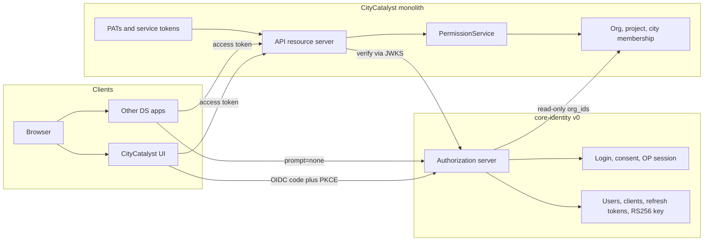

# core-identity v0 — OAuth AS gap list and isolation plan

Spike: [CC-1178](https://linear.app/openearth/issue/CC-1178/extraction-spike-on-our-oauth-as-gap-list-isolation-plan).
Implementation: [CC-1185](https://linear.app/openearth/issue/CC-1185/core-identity-v0-extract-our-as-as-a-service).

Decision already made: extend CityCatalyst’s own authorization server. Do not adopt a third-party IdP. This document is the plan CC-1185 implements.

[CC-670](https://linear.app/openearth/issue/CC-670/rfc-7591-self-service-client-registration-oauth-server-hardening) (RFC 7591 + hardening) and [CC-671](https://linear.app/openearth/issue/CC-671/login-with-citycatalyst-oidc-provider-completion-cc-as-ecosystem-idp) (OIDC provider completion) are absorbed here. Their scope is not re-ticketed. [CC-678](https://linear.app/openearth/issue/CC-678/sso-consumer-social-enterprise-logins-google-microsoft-okta-if) (Okta / Google / Microsoft as upstream IdPs) stays a separate ticket and is not part of v0.

## What exists today

OAuth is an in-process slice of the Next.js app, gated by `OAUTH_ENABLED` (off in production). CityCatalyst itself does not log in through it. Browser login is a NextAuth credentials JWT (`src/lib/auth.ts`). The authorization server is only for other apps, and nothing in production uses it yet.

| Surface | Behavior | Where |
| --- | --- | --- |
| Discovery | RFC 8414-shaped JSON at `/api/v1/oauth/metadata`. Not at `/.well-known/openid-configuration` or `/.well-known/oauth-authorization-server`. Returns 500 when the flag is off. | `src/app/api/v1/oauth/metadata/route.ts` |
| Authorize | Consent page at `/{lng}/authorize`. Requires a CityCatalyst NextAuth session. PKCE S256 required. Scopes limited to `read` and `write`. No `prompt`, no `nonce`, no OIDC. | `src/app/[lng]/authorize/page.tsx`, `AuthorizeForm.tsx` |
| Code issue | `POST /api/v1/auth/code`. Signed JWT, 5 minutes, subject = `session.user.id`. Single use is enforced by the `UsedAuthorizationCode` table (primary key on the code's `jti`), so a replay fails on any replica. Requires `session.csrfSecret`, which only the NextAuth JWT callback creates. | `src/app/api/v1/auth/code/route.ts`, `src/app/api/v1/token/route.ts`, `src/models/UsedAuthorizationCode.ts` |
| Token | `POST /api/v1/token`. `authorization_code` and `refresh_token`. HS256 with `VERIFICATION_TOKEN_SECRET`. Access token 7 days, refresh token 30 days. Refresh does not rotate and does not return a new refresh token. | `src/app/api/v1/token/route.ts` |
| Resource-server check | Bearer JWT verified with the same shared secret. `client_id` must exist. `read`/`write` gates the HTTP method. `OAuthClientAuthz` row must still exist. Then the token is turned into a full `AppSession` by loading `User`. `getBearerToken` verifies every non-PAT bearer with the shared secret and does not pin the algorithm. Climate Advisor user tokens take the same path and are told apart only by `iss` and the service-key headers. `makeOAuthUserSession` sets `expires` from `iat` instead of `exp`. | `src/util/api.ts` (`getBearerToken`, `makeOAuthUserSession`) |
| Clients | Admin-only `POST /api/v1/client`. One redirect URI. No `client_secret`, no grant list, no multiple redirects. | `src/app/api/v1/client/route.ts`, `src/models/OAuthClient.ts` |
| Consent revoke | User can delete the `OAuthClientAuthz` row. Outstanding access JWTs stay valid until they expire (up to 7 days) for any resource server that does not share this table. | `src/app/api/v1/user/clients/[client]/route.ts` |
| Login MFA | TOTP (authenticator app) plus one-time recovery codes, checked only inside the credentials `authorize()` callback. No SMS, no email OTP, no `amr`/`acr`. Consent does not step up. | `src/lib/auth.ts`, `src/lib/2fa.ts` |
| Other bearer paths | Personal access tokens (`cc_pat_…`) and Climate Advisor service tokens. Both are separate from the AS and must stay that way. | `src/lib/auth/access-token-validator.ts`, `src/util/api.ts` |

The metadata TypeScript interface already has `jwks_uri`, `registration_endpoint`, `revocation_endpoint`, and `introspection_endpoint`. None of them are returned. There is no `id_token`, no `userinfo`, no `prompt=none`.

### Shared-secret coupling (extraction blocker)

`VERIFICATION_TOKEN_SECRET` signs all of the following:

- OAuth authorization codes, access tokens, and refresh tokens (`src/app/api/v1/auth/code/route.ts`, `src/app/api/v1/token/route.ts`)
- email verification (`src/app/api/v1/auth/verify/route.ts`)
- city, organization, and user invite tokens (`src/app/api/v1/city/invite/route.ts`, `src/app/api/v1/user/invites/route.ts`, `src/backend/EmailService.ts`)
- Climate Advisor user tokens, signed in `src/app/api/v1/internal/ca/user-token/route.ts` (`src/backend/climate-advisor-token.ts` only uses the secret in a cache fingerprint)

Password reset uses a separate secret, `RESET_TOKEN_SECRET` (`src/app/api/v1/auth/forgot/route.ts`, `src/app/api/v1/auth/password/route.ts`).

An invite token, an email-verification token, a Climate Advisor user token and an OAuth access token are all HS256 JWTs under one key. Invite and verification tokens carry no `aud`, which is the only reason `apiHandler` rejects them on the bearer path (`token.aud !== origin`). JWKS cannot be published, and the AS cannot move to another process, until OAuth signing uses its own key.

Authorization codes are already durable. `token/route.ts` records each code's `jti` in the `UsedAuthorizationCode` table, and a replay fails on the primary key. That table moves with the service.

## Gap list

Priority is what unblocks “CC logs in through core-identity” and the app SDK ([CC-1186](https://linear.app/openearth/issue/CC-1186/app-sdk-sign-in-with-ds-login-silent-sso-roles)). Later items stay on the core-identity roadmap but are not v0 scope.

| # | Gap | Today | v0? | Why this priority |
| --- | --- | --- | --- | --- |
| 1 | Dedicated signing key, RS256, JWKS | HS256, shared secret, no `jwks_uri` | Yes | Every other app has to verify tokens without holding CC’s secret. Also the precondition for splitting the process. |
| 2 | OIDC discovery + `id_token` + `userinfo` | OAuth metadata only, custom path, no identity token | Yes | CC itself must be a stock OIDC relying party (NextAuth generic provider). This is the whole of CC-671. |
| 3 | Durable auth codes | Already done: `UsedAuthorizationCode` table with a primary key on `jti`. The code itself is still a signed JWT (5 minutes). | Table moves; code format changes | Replay protection works across replicas. Move the table with the service, and switch codes to opaque rows when the signing key changes (see token shape). |
| 4 | Short-lived access tokens + refresh rotation | 7-day access, refresh reused until day 30, no reuse detection | Yes | Cross-app logout and revoke are meaningless with a 7-day self-contained JWT. |
| 5 | Revocation (RFC 7009) | Deleting `OAuthClientAuthz` only affects resource servers that share the CC database | Yes | First-party apps will not share the CC database. |
| 6 | Introspection (RFC 7662) | Absent. Interface field only. | Yes | Resource servers that need immediate revoke, and any opaque handle, call this. JWT access tokens are still verified locally via JWKS; introspection is not on the hot path. |
| 7 | OP browser session + `prompt=none` | The only browser session is CC’s NextAuth cookie. Authorize always shows consent. `prompt` is ignored. | Yes | Silent SSO across apps is a session on the identity host, not a cookie inside CC. The SDK (CC-1186) only calls it. |
| 8 | Move TOTP with the credential check; emit `amr` | TOTP works, but only inside CC’s credentials provider | Yes | Login moves. The factor has to move with it. No new factor types. |
| 9 | Minimal tenancy claims | Token has `sub`, `client_id`, `scope`. Role is reloaded from `User.role` (`user` \| `admin`) at request time. | Yes, narrow | See claims below. Full roles schema is not a v0 blocker. |
| 10 | CC as relying party, behind a flag | CC never uses its own AS | Yes | CC-1185 acceptance criterion. |
| 11 | RFC 7591 dynamic client registration | Admin-only `POST /api/v1/client`. `registration_endpoint` is never advertised. | No | First-party apps are registered by us. Open self-service is the ecosystem follow-up, same service, no second extraction. Absorbs the rest of CC-670. |
| 12 | Email OTP factor | Absent | No | TOTP already covers v0 login. Email OTP is the next factor, still inside core-identity. |
| 13 | SMS OTP factor | Absent | No | Needs a provider, delivery cost, and a GDPR decision. Not required for CC login or silent SSO. |
| 14 | Okta (and Google / Microsoft) as upstream IdPs | Credentials provider only | No | Stays [CC-678](https://linear.app/openearth/issue/CC-678/sso-consumer-social-enterprise-logins-google-microsoft-okta-if). Federation plugs into the user store after v0; it does not gate the extraction. |

Client-record gaps that ride along with item 10, because the moved service should not preserve them: a single redirect URI, no confidential-client secret, refresh grant that does not authenticate the client. v0 clients are either public (PKCE) or confidential (`client_secret_basic`). Multiple redirect URIs. Still admin-registered.

## Isolation boundary

core-identity is the OpenID provider and the credential store. CityCatalyst becomes a relying party and a resource server. Domain authorization stays in CityCatalyst.

CityCatalyst is the only relying party wired in v0. Other DS apps are the same seam, consumed later by the app SDK (CC-1186). Okta, SMS, email OTP, and RFC 7591 registration are not in this picture. PATs and Climate Advisor service tokens never go through core-identity.

### Moves into core-identity

- Credential login: email, `passwordHash`, TOTP secret, recovery-code hashes. Same user UUID as today (`User.userId` becomes `sub`), so CC needs no mapping table.
- Sign-up, password reset, password change, email verification, and the 2FA setup, verify and disable routes (`auth/register`, `auth/forgot`, `auth/password`, `auth/update-password`, `auth/verify`, `auth/2fa/*`), plus the login, signup and forgot-password pages under `[lng]/auth/`. See "Decisions" below.
- The login rate limiter. Today it is an in-memory limiter in `lib/auth.ts` (5 attempts per 15 minutes per email) and does not work across replicas, so it needs a shared store in the new service.
- OP session cookie. This is new. It is not the NextAuth cookie.
- Protocol: authorize, token, revoke, introspect, userinfo, JWKS, `/.well-known/openid-configuration`.
- Signing keys (private key never leaves the service).
- `OAuthClient`, `OAuthClientI18N`, `OAuthClientAuthz`, `UsedAuthorizationCode`, authorization codes, refresh-token families.
- CSRF protection for the consent step. Today `auth/code` checks a token derived from `session.csrfSecret`, which only the NextAuth JWT callback creates. The identity service needs its own.
- Consent UI (the current `/{lng}/authorize` page, moved or rehosted). Login UI for the hosted flow.

### Stays in the monolith

- Product data: `Organization`, `Project`, `City`, inventories, modules.
- Membership writes: `OrganizationAdmin`, `ProjectAdmin`, `CityUser`. These remain CC-owned until the hierarchy schema ([CC-1063](https://linear.app/openearth/issue/CC-1063/define-gcom-ds-project-hierarchy-schema-v0)) is frozen and a later ticket moves membership.
- `PermissionService` and every city/inventory/project check. Tokens do not become an authorization engine.
- Personal access tokens (`cc_pat_…`) and the Climate Advisor service-key path. They are CC API credentials, not AS tokens.
- Invites (they carry membership, and they stay signed with `VERIFICATION_TOKEN_SECRET`), org-frozen checks, admin chrome, and `User.role`. Email delivery for sign-up, verification and password reset moves with the credential flows. Do not block the extraction on the mailer: the new service may call a single CC mail endpoint at first.
- The `User` row itself, as a profile record keyed by `sub`. See "Decisions" below.
- The Chakra admin client list. It becomes a client of the core-identity admin API. Do not rebuild product UI inside the identity service.

### The seam

1. Browser hits CC. CC has no session. CC redirects to core-identity (`/authorize`, PKCE, CC’s client id).
2. core-identity authenticates (password + TOTP if enrolled) and sets its own session cookie.
3. core-identity redirects back with a code. CC’s token handler exchanges it and stores an RP session.
4. CC API calls from other apps send the access token. CC verifies the JWT signature against JWKS, checks `iss`/`aud`/`exp`, and authorizes with `PermissionService` using `sub`. CC stops calling `jwt.verify` with `VERIFICATION_TOKEN_SECRET` for access tokens.
5. A second app uses `prompt=none`. If the OP cookie is present, core-identity returns a code with no UI.

`apiHandler` must not load a CC `User` row and synthesize an `AppSession` as the way it “validates OAuth”. That coupling is what makes the AS inseparable from the monolith today (`makeOAuthUserSession` in `src/util/api.ts`). After the cut, validation is cryptographic. The user row is only needed when a handler needs profile fields.

### Tenancy claims (v0, deliberately small)

[CC-1063](https://linear.app/openearth/issue/CC-1063/define-gcom-ds-project-hierarchy-schema-v0) is still open and [CC-1065](https://linear.app/openearth/issue/CC-1065/define-gcom-ds-user-roles-schema-v0-roles-permission-groups-scope) is a roles schema, not an enforcement engine. v0 must not invent the DS role catalogue inside the token.

Access token and `id_token` claims in v0:

| Claim | Source in v0 | Notes |
| --- | --- | --- |
| `sub` | `User.userId` | Stable UUID. |
| `email`, `email_verified`, `name` | User row | `email_verified` matches the existing verification flag. |
| `amr` | `["pwd"]` or `["pwd","otp"]` | Records how this login happened. |
| `org_ids` | Read-only snapshot of org membership at token issue | Best-effort from `OrganizationAdmin` plus orgs reached through `ProjectAdmin` / `CityUser`. Empty array is valid. |
| `active_org_id` | Omitted when CC has no single active org | Do not guess. Apps that need a selected org ask the user. |

`scope` stays `openid` plus the existing `read` / `write` for the CC API. DS roles and permission groups are evaluated by each app (and later by an authz service) from `sub` and `org_ids`. They are not scopes and they are not copied into the token in v0.

How `org_ids` is read without moving membership: a read-only view (or a single internal query) that core-identity uses at token issuance. CC keeps the write path. When CC-1063 lands, the view is replaced. Tokens minted before a membership change stay wrong until refresh; that is acceptable because access tokens are short-lived (below).

### Token shape for v0

- Access token: JWT, RS256, 15 minutes, `aud` = the platform resource indicator (one audience for v0, not “whatever origin served the request”).
- Refresh token: opaque, stored hashed, 30 days, rotated on every use, reuse revokes the family.
- `id_token`: RS256, `nonce` echoed, 15 minutes.
- Authorization code: opaque row, 60 seconds, single use, bound to client, redirect, PKCE challenge, and user.

## Extraction order

Do the protocol fix inside the monolith first, then move the process. The flag stays off in production until CC login through the new service is proven in dev.

1. **Split the signing key.** New `OAUTH_SIGNING_KEY` (RS256). Leave `VERIFICATION_TOKEN_SECRET` on invites, email verification and Climate Advisor user tokens. Password reset already uses `RESET_TOKEN_SECRET`. No external verifier is published before this split.
2. **Make the protocol real, still in-process, still behind `OAUTH_ENABLED`.** Durable codes, JWKS, `/.well-known/openid-configuration`, `id_token`, `userinfo`, refresh rotation, revocation, introspection, `prompt=none`. Contract tests from [CC-1176](https://linear.app/openearth/issue/CC-1176/freeze-platform-contracts-v1-openapi-auth-contract-event-schemas) go green against this monolith.
3. **Cut CC’s resource-server check over to JWKS.** `getBearerToken` no longer uses the shared secret for OAuth access tokens. It must dispatch on `iss`, because Climate Advisor user tokens (`iss` = `climate-advisor-service`) still go through the same function with the shared secret. Pin the algorithm to RS256 for OAuth tokens. PAT and service tokens unchanged. Fix `makeOAuthUserSession` to set `expires` from `exp`, not `iat`.
4. **Extract the process.** New `core-identity` service owns the tables and routes from the “Moves” list. Same user UUIDs. CC admin UI and consent page call it. Deploy in dev only.
5. **CC logs in as a relying party, behind a flag.** NextAuth OIDC provider pointed at core-identity. Credentials provider remains the fallback until the flag is the dev default. This is the CC-1185 acceptance check.
6. **Delete the in-process AS routes** once dev uses the service. Do not keep two token endpoints.
7. **Fast-follow, same service:** RFC 7591 and a developer registration page (rest of CC-670), then email OTP. SMS and Okta stay outside this sequence (CC-678 for Okta).

[CC-1184](https://linear.app/openearth/issue/CC-1184/split-inside-execution-wave-1-packages-lint-boundaries-owned-db) (owned Postgres schemas) can run in parallel. The first owned schema for this work is the identity schema (`User` credential columns, OAuth tables, codes, refresh tokens, signing keys). Cross-schema foreign keys from those tables to `Organization` / `Project` are dropped; `org_ids` is a snapshot, not an FK.

## Decisions (2026-11-16)

These record the direction agreed after the spike. They replace anything above that says otherwise, including the "owned Postgres schemas" note for CC-1184.

### Service shape

- The service lives in its own repository, not in the CityCatalyst monorepo. It has its own Dockerfile, CI workflows and k8s manifests later. Repository name and location: to be set when the repository is created.
- Stack for the MVP: Next.js, extracting the existing logic first. No NestJS and no rewrite before the extraction works in isolation.
- Separate database. The tables listed under "Moves into core-identity" go to the identity database. There are no foreign keys across the two databases.
- Pages are meant to be composed into the main app by route mapping on one origin, not by iframes.

### `User` record

- CityCatalyst keeps a `User` row for profile data (name, title, picture, language, number format, defaults) and organization membership. All authentication logic leaves it. `User.userId` equals the identity `sub`, so existing foreign keys keep working.
- Credential columns leave `User`: `password_hash`, `two_factor_enabled`, `two_factor_secret`, `two_factor_recovery_hashes`. `last_active_at` feeds the retention job and needs a sign-in signal from the identity service.
- Sign-up moves to the identity service.
- The identity service owns `email` as the login identifier. CityCatalyst keeps a copy for display, invites and notifications. How a change reaches that copy is open.
- `User.role` stays in CityCatalyst. It is authorization data, not a credential.

### Deletion

- The shell frontend (CityCatalyst for now) calls the identity service API to delete the identity record. CityCatalyst then deletes or anonymizes its own `User` row.
- Data that must outlive the user keeps its row and the user reference becomes null.
- Today's `POST /api/v1/auth/delete` hard-deletes by email in one unguarded call and has no UI caller that I found. The GDPR retention job already anonymizes in a transaction and keeps the `User` row, which is the closer model.

### Foreign keys to `User`

Audit of `app/src/models` and `app/migrations`, 22 columns.

| Disposition | Columns |
| --- | --- |
| Delete with the user | `CityUser.user_id`, `OrganizationAdmin.user_id`, `ProjectAdmin.user_id`, `OAuthClientAuthz.user_id`, `PersonalAccessToken.user_id` |
| Already set null | `CityInvite.user_id`, `OrganizationInvite.user_id`, `HighImpactActionRanking.user_id`, `WebhookSubscription.created_by`, `MeedRanking.user_id`, `BulkInventoryImportJob.user_id`, `ConsentRecord.user_id`, `IngestJob.uploaded_by_user_id`, `IngestItem.review_locked_by_user_id`, `IngestDocument.uploaded_by_user_id` |
| Keep with a null user. Needs a migration (drop `NOT NULL`, `ON DELETE SET NULL`) | `Version.author_id` (today `NOT NULL` with no `ON DELETE` rule, so `User.destroy` fails for anyone who edited inventory values), `ImportedInventoryFile.user_id`, `UserFile.user_id` |
| Not decided | `CityInvite.inviting_user_id` and `ProjectInvite.user_id` cascade, so deleting an inviter removes other people's invites. `NativeInputCatalog.user_id` has no foreign key. `ActionPlan.created_by` is a string with no foreign key. |

The model files and the database also disagree in places (for example `CityInvite.user_id` references a column named `id`, and `User.default_project_id` exists only in a migration). The migrations are the source of truth.

### Open questions

- How CityCatalyst learns about a user created in the identity service, and how email changes sync back.
- The `email_verified` claim. I found no verification flag on `User`, so it has no source today.
- Whether the three undecided foreign keys above should become `SET NULL`.
- Whether `util/gdpr/personal-data-inventory.ts` and the retention job move, split, or call the identity service.

## What v0 does not do

- Replace `PermissionService` or encode the CC-1065 role catalogue in tokens.
- Move `Organization` / `Project` / `City` or their membership writes.
- Issue or validate personal access tokens.
- Register arbitrary third-party clients (RFC 7591).
- Send SMS, or accept Okta / Google / Microsoft logins.
- Build the app SDK. That is CC-1186, which consumes `prompt=none` and the claims above.
- Turn the flag on in production. Dev deployment plus CC login behind a flag is the v0 bar. Production enablement is a later change once the security review from CC-670 has a real service to review.

## CC-670 and CC-671

Confirmed: both are duplicates of CC-1185, not parallel work.

- CC-671 is entirely inside steps 2 and 5 (OIDC discovery, `id_token`, `userinfo`, `jwks_uri`, CC as the first real client). The “pilot external app” acceptance criterion is satisfied by CC logging in through the service, plus the platform-contracts auth tests. `api-demo/` can be a second client after that; it is not a separate project.
- CC-670 splits. RS256, JWKS, revocation, introspection, and refresh rotation are v0 (steps 1–2). RFC 7591, the developer registration page, and production enablement are the fast-follow. They still belong to core-identity, not a revived CC-670.

CC-678 is not absorbed.
